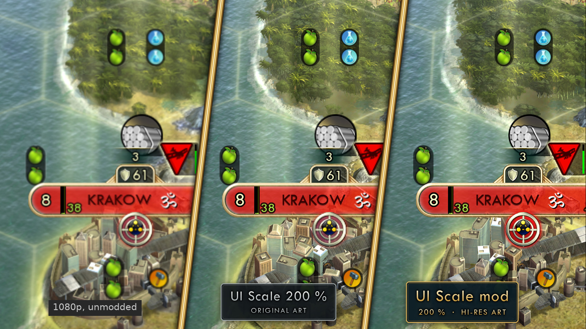
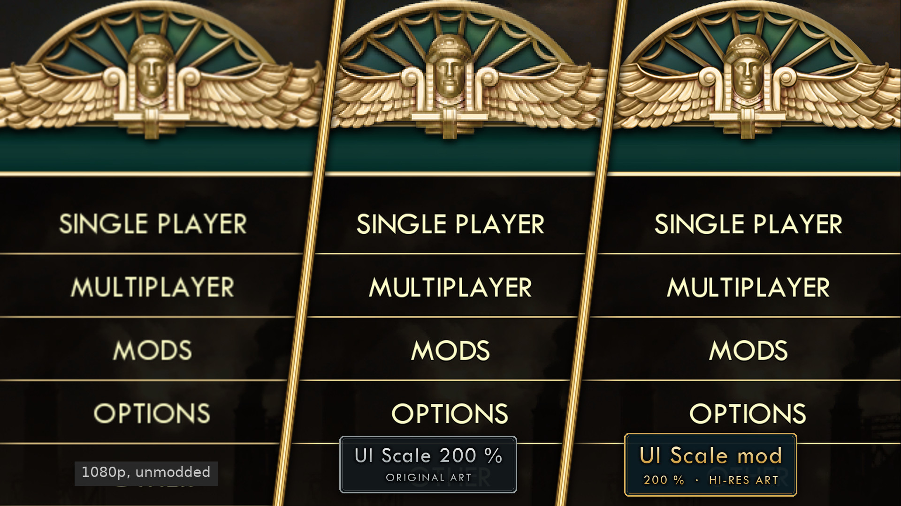
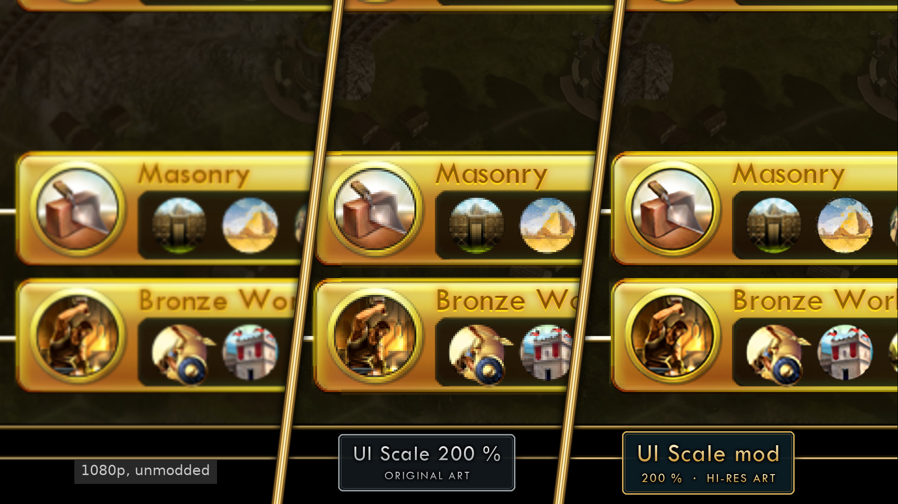
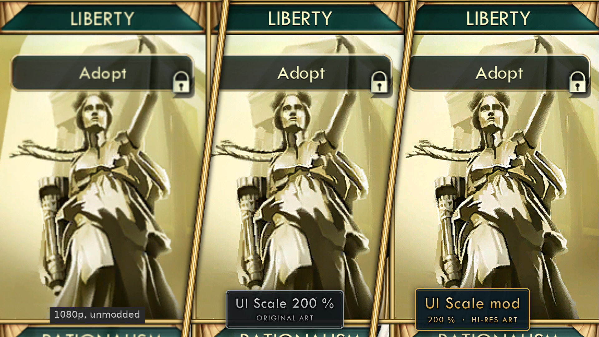
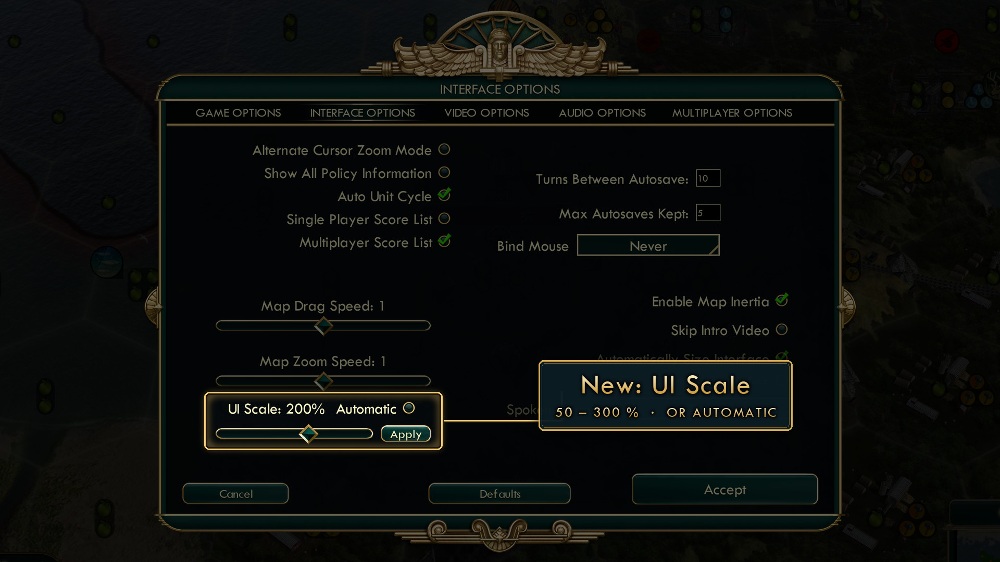
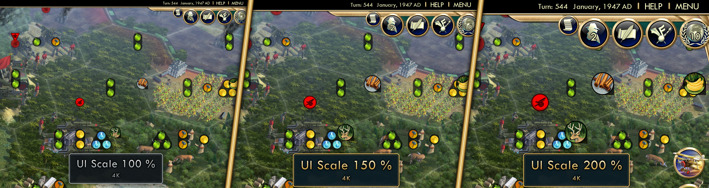
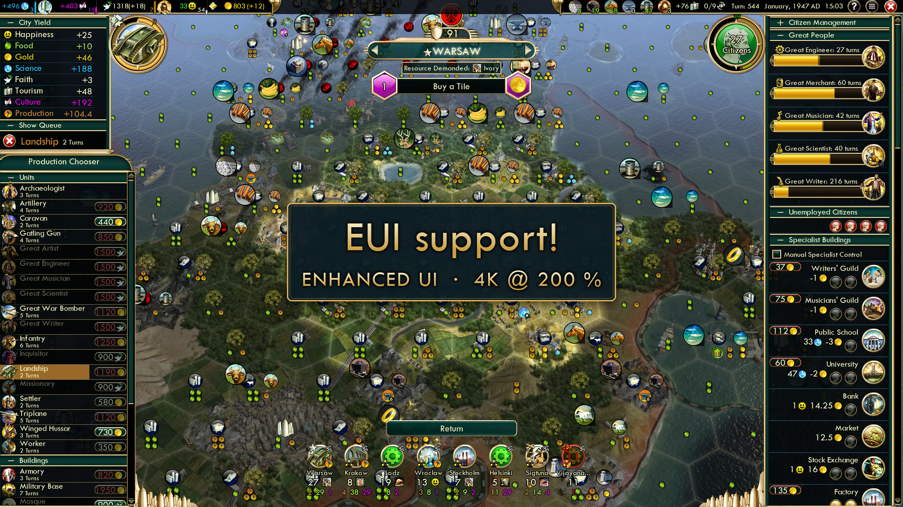

# Civ V UI Scale


Makes the Civilization V interface crisp and readable at 1440p, 4K and above.

- resolution-independent UI scaling: a **UI Scale** slider in *Options → Interface Options*
  (50–300 %, or automatic: height / 1080)
- hi-res fonts and hi-res UI art (frames, buttons, city banners, icons, portraits, ...) at 2× / 3×

Works on Windows and on Linux (Steam + Proton) with the Steam DX11 version of the game, and with
any combination of DLC. The native Linux port of Civ V (OpenGL) is not supported.

Works with Enhanced UI (EUI) and Vox Populi's EUI in any install order: the UI Scale slider is
added to whichever options menu the game loads (`PatchOptionsMenu=0` in `UIScale.ini` limits
this to the base game's menu).

## Screenshots

The same section of a 4K screen three times, zoomed in, everything the same size. Left: the
unmodded game at 1080p, stretched to the 4K screen. Middle: native 4K with UI Scale at 200 % and
the game's original art. Right: the same with the hi-res art (it can be switched off with
`AIArt=0`).






The UI Scale slider in *Options → Interface Options*, and what it does at 4K: the top-right corner
of the map view at 100, 150 and 200 %.




Enhanced UI at 4K / 200 % (EUI's own icons keep their original resolution):



## Install

**Windows:** download `CivVUIScale-Setup.exe` from the latest release and run it. It fetches
the art pack (`civ5-uiscale-art-x2.pack`) itself, or uses one placed next to it.

On Windows the mod is installed as `msimg32.dll` next to the game exe (on Linux it is
`version.dll`, see below). Windows Security may flag it. That is a false alarm: the mod loads into
the game through a proxy DLL, the same way some malware does, and the DLL is not code-signed.
If the installer reports that it was blocked, open *Windows Security → Virus & threat protection
→ Protection history*, choose *Allow on device* for `msimg32.dll`, and click Install again.

On Windows the strategic-view icon alignment fix is off by default: it uses a hardware
breakpoint, and the game's Steam DRM crashes the game when it finds one. Under Linux / Proton it
is on. (`StrategicViewFix` in `UIScale.ini`.)

**Linux:** download `civ5-uiscale-setup-linux.tar.gz`, unpack it and run `./install.sh`.
Then set the Steam launch options of Civilization V to

```
WINEDLLOVERRIDES="version=n,b" %command%
```

(the installer shows this line with a copy button).

The installer finds the game in any Steam library (other drives, Flatpak / Snap Steam included);
you can also pick the folder yourself. Run it again to update, change options or uninstall.

### Font

Civ V uses *Tw Cen MT*. For the text to render correctly at larger scales, install that font on
your computer (or download the .ttf and point the installer at it with *Choose .ttf file…*); the
installer then renders the game's text from it. Without it the fonts look wonky. The font is easy
to find: search the web for "Tw Cen MT font download".

### Where does the hi-res art come from?

The upscaled art is derived from Firaxis' textures, so it is distributed encrypted: every file can
only be unlocked with the matching original from your own game files. Without the game the pack is
noise, and art of DLC you do not own stays locked.

Settings: `My Games/Sid Meier's Civilization 5/UIScale.ini` · Log: `Logs/UIScale.log`
(`AIArt=0` disables the art). If the mod cannot attach to the game's graphics it keeps the
interface at its normal size for that session and shows a warning instead of a broken UI.
